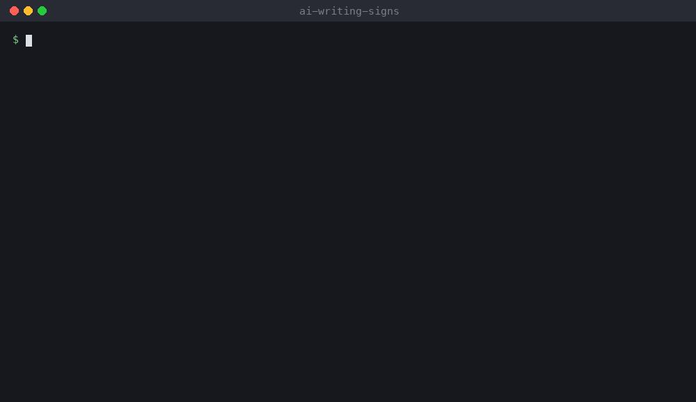

# ai-writing-signs

[](https://github.com/aroyy007/ai-writing-signs/actions/workflows/ci.yml)
[](https://github.com/aroyy007/ai-writing-signs/releases/latest)


[](#license)



A Claude skill for finding and fixing the habits of unedited LLM text: era vocabulary
("delve", "tapestry", "leverage"), stock sentence templates ("not just X, but Y",
"serves as a testament to"), leaked chatbot artifacts (`oaicite`,
`utm_source=chatgpt.com`, "I hope this helps"), invisible Unicode characters, and
academic over-claiming.

It ships with `scan.py`, a dependency-free Python scanner that does the mechanical part
(counting and locating candidates per paragraph) so the model only has to judge the
paragraphs it flags.

This is an editing aid. It does not promise that text will pass an AI detector, and it
is not meant to get around a venue's AI-use disclosure rules.

## What it checks

| Group | Examples | How |
|---|---|---|
| Hard artifacts | "Certainly!", `[Insert statistic]`, `oaicite`, `utm_source=chatgpt.com`, knowledge-cutoff disclaimers | scanner, flags on a single hit |
| Vocabulary by model era | GPT-4: delve, tapestry, pivotal · GPT-4o: showcasing, fostering · GPT-6: leverage, quietly, multifaceted | scanner |
| Sentence templates | copula avoidance, negative parallelism, tailing "-ing" clauses, inflated significance, false ranges | scanner + judgment |
| Attribution | "experts argue", "studies show", vague "associated with", media-coverage framing | scanner |
| Formatting | bold-lead bullets, Title Case headings, emoji bullets, spaced em dashes, curly quotes | scanner stats |
| Invisible Unicode | zero-width spaces, soft hyphens, bidi controls, tag characters, noncharacters | scanner, `--clean` strips them |
| Academic text | over-claiming verbs, novelty padding, "sheds light on", claim–evidence gaps | scanner + `references/academic.md` |
| Judgment-only | rule of three, elegant variation, superficial analysis, template sections | model, using `references/patterns.md` |

No single sign proves anything. The skill reports density: several patterns clustered
in one paragraph.

## Install

**Claude Code plugin**

```
/plugin marketplace add aroyy007/ai-writing-signs
/plugin install ai-writing-signs@ai-writing-signs
```

**Claude Code, manual**

```bash
git clone https://github.com/aroyy007/ai-writing-signs.git
cp -R ai-writing-signs/skills/ai-writing-signs ~/.claude/skills/
```

**Claude.ai / Claude desktop**

Download `ai-writing-signs.skill` from the
[latest release](https://github.com/aroyy007/ai-writing-signs/releases/latest) and upload
it under Settings → Capabilities → Skills. Or build it yourself:

```bash
python3 tools/build_skill.py   # writes dist/ai-writing-signs.skill
```

## Use

In Claude, ask for it in plain words ("check this draft for AI tells", "humanize this
section") or run `/ai-writing-signs`. The skill has three modes:

- **Audit:** a table of exact quotes, pattern, and fix, plus a density read and verdict.
- **Rewrite:** edits only what was flagged, keeps the author's voice, returns a change log.
- **Write:** a silent pre-submission filter when Claude drafts text for you.

The scanner also works on its own:

```bash
python3 skills/ai-writing-signs/scripts/scan.py draft.md
python3 skills/ai-writing-signs/scripts/scan.py draft.md --json
pbpaste | python3 skills/ai-writing-signs/scripts/scan.py -
python3 skills/ai-writing-signs/scripts/scan.py draft.md --clean -o draft.clean.md
```

Scores are heuristics. Hits inside quotations or technical terms ("robust" in
statistics) are not tells.

## Before and after

From [`examples/before.md`](examples/before.md), a paper introduction (score 25.6 per
100 words, 3 of 3 paragraphs flagged):

> To address this, we propose LiteQ, a novel and groundbreaking quantization framework
> that not only reduces memory but also enhances accuracy, paving the way for efficient
> on-device inference. Extensive experiments demonstrate that LiteQ achieves superior
> performance, reducing memory by 4.1× while improving accuracy by 0.8 points on MMLU,
> underscoring its effectiveness.

After the skill's rewrite mode ([`examples/after.md`](examples/after.md), score 0):

> We propose LiteQ, a quantization method for on-device inference. On MMLU it reduces
> memory by 4.1× and improves accuracy by 0.8 points over the 16-bit baseline.
> [needs evidence: comparison with the strongest quantization baselines, and the
> latency numbers the first paragraph promises]

The numbers stay exactly as they were. Where the original made a claim without
support, the rewrite flags it for the author instead of making up a citation.

## Repository layout

```
.claude-plugin/          plugin + marketplace manifests
skills/ai-writing-signs/
  SKILL.md               instructions Claude loads
  references/
    patterns.md          full pattern catalog, ineffective indicators, write-mode filter
    academic.md          papers, theses, rebuttals, grant proposals
  scripts/scan.py        stdlib scanner (Python 3.8+)
examples/                before/after sample
tests/                   unittest suite + fixtures
tools/build_skill.py     packages dist/ai-writing-signs.skill
tools/make_assets.py     regenerates docs/assets (needs Pillow)
```

## Development

```bash
python3 -m unittest discover -s tests -v
python3 tools/build_skill.py
```

Word lists and regexes live in the `PATTERNS` table at the top of `scan.py`. If you add
a category, describe it in `references/patterns.md` and add a test.

## Sources and credits

- [Wikipedia: Signs of AI writing](https://en.wikipedia.org/wiki/Wikipedia:Signs_of_AI_writing),
  WikiProject AI Cleanup (CC BY-SA 4.0). Most of the pattern catalog is adapted from here.
- [academic-humanizer](https://github.com/AIScientists-Dev/academic-humanizer) (MIT):
  claim–evidence discipline and the grant-proposal mode.
- [watermarks-remover](https://github.com/guillaumemeyer/watermarks-remover): the
  invisible-Unicode character classes.

## License

- Code (`scan.py`, `tests/`, `tools/`): [MIT](LICENSE).
- Documentation and pattern catalog (`SKILL.md`, `references/`, this README): adapted
  in part from Wikipedia, so licensed under [CC BY-SA 4.0](LICENSE-DOCS.md).
